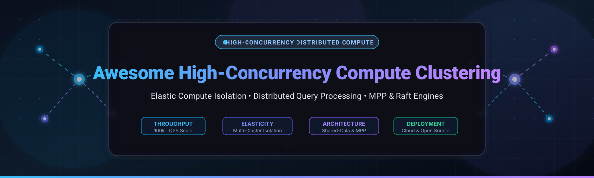
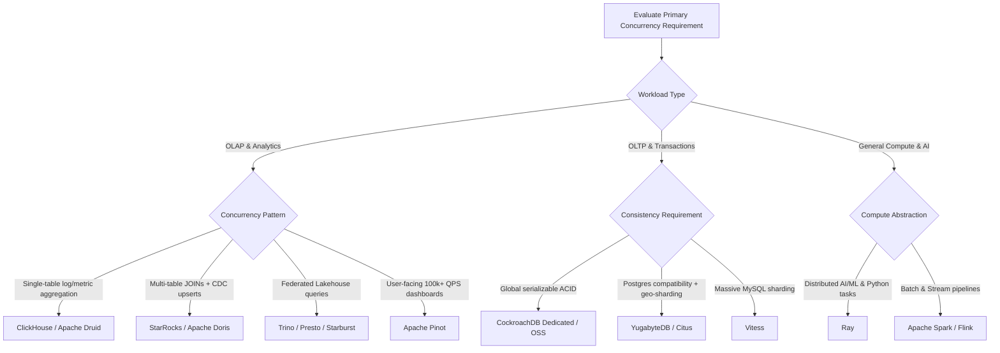

  

# ⚡ Awesome High-Concurrency Compute Clustering 🚀

  
  
  
  
  
  

A curated directory of elite enterprise **SaaS platforms** ☁️ and battle-tested **open-source distributed compute frameworks** 🛠️ engineered for **High-Concurrency Compute Clustering**, elastic workload isolation, massively parallel processing (MPP), and distributed query execution under extreme query-per-second (QPS) scale.

---

## 📑 Table of Contents

- [📌 Overview](#-overview)
- [📊 Sector Overview & Market Dynamics](#-sector-overview--market-dynamics)
- [☁️ Enterprise SaaS & Hosted Platforms](#️-enterprise-saas--hosted-platforms)
- [🛠️ Open-Source Compute Clustering Engines](#️-open-source-compute-clustering-engines)
- [🏗️ Architecture & Selection Guide](#️-architecture--selection-guide)
- [⭐ Star History](#-star-history)
- [🤝 How to Contribute](#-how-to-contribute)
- [💖 Support & Sponsorship](#-support--sponsorship)
- [📜 Disclaimer](#-disclaimer)

---

## 📌 Overview

Modern data-intensive enterprises face the challenge of serving tens of thousands of concurrent analytical and transactional queries across mixed workloads—such as low-latency business intelligence (BI) dashboards 📈, complex ad-hoc analytics 🔍, automated data transformations 🔄, and machine learning pipelines 🤖—without resource starvation or query queuing.

**High-concurrency compute clustering** addresses this challenge via:
- 🧊 **Decoupled Storage and Compute:** Independent elasticity allowing compute clusters to scale dynamically without rebalancing storage.
- 🛡️ **Compute Groups & Workload Isolation:** Segmenting read, write, and ingestion workloads to prevent noisy-neighbor degradation.
- ⚡ **Dynamic Slot/Replica Scheduling:** Distributing query tasks dynamically across worker clusters with cache-locality awareness.
- 🔄 **Multi-Raft Consensus:** Ensuring global ACID transactional consistency under massive concurrent write throughput.

---

## 📊 Sector Overview & Market Dynamics

The global cloud data warehousing and distributed query engine market is estimated at **$14.2 billion** (projected to exceed **$52 billion by 2032** growing at ~23.5% CAGR), while the high-concurrency distributed database market accounts for an additional **$2.8 billion to $12 billion** across OLAP and Distributed SQL tiers. 🌐

The sector is **moderately concentrated** at the top tier: hyperscalers (Google Cloud BigQuery, AWS Redshift) and specialized market leaders (Snowflake, Databricks) capture the vast majority of enterprise spend through deeply integrated cloud ecosystems. However, the operational layer remains **vibrantly fragmented** around real-time OLAP, federated query engines, and open-source distributed runtimes (e.g., ClickHouse, StarRocks, Ray, Trino, Apache Spark), where specialized workloads resist a single "winner-take-all" outcome. 💡

---

## ☁️ Enterprise SaaS & Hosted Platforms

The table below compares top-tier hosted and managed platforms providing high-concurrency elastic compute clustering, ranked in descending order by company valuation / market capitalization. 💼

| SaaS / Hosted Platform | Company Size (Valuation / Revenue) 🏢 | Starting Pricing (Specific Tier) 💳 | Free Tier / Trial Limits 🎁 | Key Concurrency Architecture ⚙️ |
| :--- | :--- | :--- | :--- | :--- |
| **[Google Cloud BigQuery Autoscaling](https://cloud.google.com/bigquery/docs/slots-autoscaling-intro)** | **~$2.1 Trillion** (Alphabet MCap) / ~$350B+ Revenue | **$0.04 per slot-hour** (Standard Edition autoscaling slots); $6.25 per TiB on on-demand | **Free forever tier:** 1 TiB query analysis scanned per month + 10 GiB active/long-term storage free each month (on-demand model) | Slot-based fluid autoscaling with dynamic idle slot sharing across reservations in 50-slot increments without query queuing. |
| **[Amazon Redshift Multi-Cluster](https://aws.amazon.com/redshift/)** | **~$2.0 Trillion** (Amazon MCap) / ~$600B+ Revenue | **$0.375 per RPU-hour** (Serverless, 60-second minimum); or $0.25/hr for provisioned dc2.large | **$300 free credit** valid for **90 days** for Amazon Redshift Serverless; or **2-month free trial** of 750 dc2.large hours/month | Multi-cluster data sharing with live transactional writes across provisioned clusters and serverless workgroups without data replication. |
| **[Snowflake Multi-Cluster Warehouses](https://docs.snowflake.com/en/user-guide/warehouses-multicluster)** | **~$55 Billion** (Snowflake MCap) / ~$3.6B ARR | **$3.00 per credit** (Enterprise Edition list price, AWS US East; required for multi-cluster warehouses) | **30-day free trial** with **$400 in free usage credits**; no permanent free tier | Automatically adds/removes worker clusters (1 to 10+ clusters per warehouse) dynamically based on concurrency load and scaling policy. |
| **[Databricks Multi-Cluster](https://www.databricks.com/)** | **~$43 Billion** (Private Valuation) / ~$2.6B+ ARR | **$0.55 per DBU-hour** (Premium All-Purpose Compute, AWS US East) + underlying cloud VM costs | **14-day free trial** of Databricks platform DBU compute (cloud VM infrastructure billed separately by provider) | Enhanced Autoscaling dynamically monitors task slot queue depth and proactive node lifecycle management for multi-cluster lakehouses. |
| **[CockroachDB Dedicated](https://www.cockroachlabs.com/)** | **~$5.0 Billion** (Valuation) / ~$150M+ Revenue | **$0.18 per vCPU-hour** (Standard tier baseline); Serverless at $0.10 per 10M Request Units beyond free tier | **Free forever basic tier:** 50M Request Units (RUs) and 10 GB storage free each month; Dedicated includes custom proof-of-concept credits | Distributed SQL engine backed by multi-Raft consensus, automated range splitting, and cross-region elastic scale for ACID concurrency. |
| **[Starburst Galaxy](https://www.starburst.io/)** | **~$3.35 Billion** (Valuation) / ~$100M+ Revenue | **$0.50 per credit** (Pro Tier); Enterprise Tier starts at **$0.75 per credit** | **30-day free trial** with **$500 in free credits** (Enterprise tier features); downgrades to free tier with up to 3 forever-free clusters | Fully-managed Trino platform featuring Warp Speed query acceleration, cluster autoscaling, and cross-cloud federated query execution. |
| **[SingleStore Distributed Architecture](https://www.singlestore.com/)** | **~$1.3 Billion** (Valuation) / ~$100M+ ARR | **$0.99 per hour** (S-00 workspace tier: 0.25 Compute Credits/hr @ $3.96/credit on-demand) | **Free Shared Tier:** Forever-free shared-compute workspace with 1 GB compressed storage; plus **$600 in promotional trial credits** | Single-engine universal storage (rowstore + columnar) handling concurrent transactional ingest and analytical queries simultaneously. |
| **[YugabyteDB Managed](https://www.yugabyte.com/)** | **~$1.3 Billion** (Valuation) / ~$75M+ Revenue | **$0.17 per vCPU-hour** (Pay-as-you-go capacity rate on Standard Cloud) | **Free forever sandbox cluster:** 1 node, 2 vCPUs, 4 GB RAM, 10 GB storage; plus a **14-day full-feature trial** with multi-node dedicated clusters | Spanner-inspired distributed SQL engine (PostgreSQL compatible) featuring Raft replication and localized read replicas for high throughput. |
| **[Imply Polaris](https://imply.io/)** | **~$1.1 Billion** (Valuation) / ~$60M+ ARR | **$0.137 per hour** (Starter Project tier: 4 vCPUs, 16 GB RAM, 25 GB storage) | **30-day free trial** with **$500 in platform credits**; streaming and batch ingestion fees waived during trial | Managed Apache Druid service with auto-scaling compute groups, sub-second OLAP slicing, and decoupled deep storage. |

---

## 🛠️ Open-Source Compute Clustering Engines

The following high-performance open-source distributed engines, databases, and compute runtimes power modern self-hosted high-concurrency clusters. Repositories are sorted in descending order by GitHub stargazers. 🌟

| Project & Repository | GitHub_Stars ⭐ | Architecture & Primary Use Case 🎯 | Concurrency & Isolation Characteristics 🛡️ |
| :--- | :--- | :--- | :--- |
| **[ClickHouse](https://github.com/ClickHouse/ClickHouse)** |  | Columnar MPP database for real-time analytics, observability, and time-series aggregation. | Uses **parallel replicas** dynamically distributing work across cluster nodes with cache-locality awareness; best for extreme single-table query throughput. |
| **[Apache Spark](https://github.com/apache/spark)** |  | Unified distributed compute engine for large-scale data engineering, streaming, and SQL. | Scales to thousands of nodes via Standalone, Kubernetes, or YARN; dynamic allocation adjusts executor pools dynamically based on task queue pressure. |
| **[Ray](https://github.com/ray-project/ray)** |  | Unified framework for scaling AI, machine learning training, hyperparameter tuning, and Python apps. | Actor-based distributed scheduling with microsecond task latency and auto-scaling clusters across heterogeneous CPU/GPU compute pools. |
| **[DuckDB](https://github.com/duckdb/duckdb)** |  | High-performance embeddable analytical database with columnar vectorized execution. | Maximizes per-node multi-threaded concurrency; frequently embedded as worker nodes within distributed serverless orchestration tiers. |
| **[CockroachDB](https://github.com/cockroachdb/cockroach)** |  | Distributed SQL database with multi-active availability and serializable ACID consistency. | Implements Raft consensus per range and distributed leaseholder routing to handle massive concurrent transaction rates across geographically dispersed nodes. |
| **[Apache Flink](https://github.com/apache/flink)** |  | Distributed stream and batch processing framework for stateful computations. | Fine-grained resource isolation and slot sharing groups enable high-throughput low-latency event processing with exactly-once state semantics under load. |
| **[Vitess](https://github.com/vitessio/vitess)** |  | Cloud-native horizontal database clustering and sharding middleware for MySQL. | Handles massive horizontal connection pooling via VTGate proxy routers; splits query load and protects backend databases from connection floods. |
| **[Presto](https://github.com/prestodb/presto)** |  | Distributed MPP SQL query engine for large-scale interactive analytics across multiple sources. | Separates coordinator and worker nodes; dynamic pipelined execution streams intermediate data over the network without writing to local disk. |
| **[Apache Doris](https://github.com/apache/doris)** |  | High-speed MPP analytical database featuring vectorized execution and MySQL compatibility. | Decoupled compute groups allow independent read/write isolation; vectorized query engine provides high concurrency across interactive dashboards. |
| **[Apache Druid](https://github.com/apache/druid)** |  | High-performance real-time analytics database designed for sub-second analytical queries. | Segment-based distributed architecture separating Historical, Broker, and MiddleManager processes for concurrent slicing and dicing. |
| **[Dask](https://github.com/dask/dask)** |  | Flexible library for parallel computing and task scheduling in Python. | Dynamic distributed task graphs with responsive work-stealing schedulers enable multi-tenant cluster compute on HPC and Kubernetes clusters. |
| **[Trino](https://github.com/trinodb/trino)** |  | High-concurrency MPP SQL query engine for data lakes, lakehouses, and federated stores. | Employs adaptive cluster queuing, cost-based optimizer (CBO), and fault-tolerant task-level execution for concurrent multi-tenant querying. |
| **[Citus](https://github.com/citusdata/citus)** |  | Open-source PostgreSQL extension that transforms Postgres into a distributed multi-tenant database. | Shards tables across worker nodes and parallelizes query execution while routing tenant-specific queries to dedicated nodes for workload isolation. |
| **[StarRocks](https://github.com/StarRocks/starrocks)** |  | Next-generation sub-second MPP database designed for Snowflake-like elasticity. | **Compute groups** allow complete read-read, read-write, and write-write isolation on object storage without data migration; outstanding CBO for complex multi-table JOINs. |
| **[YugabyteDB](https://github.com/yugabyte/yugabyte-db)** |  | Cloud-native distributed SQL database supporting PostgreSQL wire compatibility. | Spanner-style architecture using DocDB and Raft replication; distributes tablet leaders and read replicas horizontally to absorb concurrent transactional loads. |
| **[Apache Arrow DataFusion](https://github.com/apache/arrow-datafusion)** |  | Extensible, vectorized SQL query engine written in Rust using Apache Arrow memory format. | Serves as the compute core for next-gen distributed clustering engines (e.g., Ballista); offers unmatched thread-level multi-core concurrency. |
| **[Apache Iceberg](https://github.com/apache/iceberg)** |  | Open table format for massive analytic datasets with full ACID transaction guarantees. | Optimistic concurrency control (OCC) enables multiple isolated compute engines (Spark, Trino, Flink, StarRocks) to concurrently write and read snapshot data safely. |
| **[Apache Pinot](https://github.com/apache/pinot)** |  | Real-time distributed OLAP datastore designed for ultra-low latency analytics at scale. | Highly optimized for user-facing high-QPS applications; horizontally partitioned segments and specialized indexes provide millisecond response times under tens of thousands of QPS. |

---

## 🏗️ Architecture & Selection Guide

Selecting the appropriate high-concurrency compute clustering architecture depends directly on query workload patterns, latency requirements, and operational constraints:

### ⚖️ Key Architectural Trade-Offs

1. **Shared-Data vs. Shared-Nothing:**
   - **Shared-Data (Object Storage):** StarRocks, Snowflake, BigQuery. Decouples compute from storage; compute clusters can be scaled to zero, paused, or multiplied without reshuffling underlying data.
   - **Shared-Nothing (Local NVMe/Disks):** Traditional ClickHouse, Apache Druid. Offers highest raw IOPS for local cache hits, but scaling requires rebalancing data partitions across worker nodes.

2. **Workload Isolation:**
   - **Compute Groups / Virtual Warehouses:** Isolate background batch ETL jobs from interactive BI queries so that long-running transformations never monopolize CPU cycles or query queues.
   - **Dynamic Queue Management:** Commercial platforms (Snowflake, BigQuery) manage queuing transparently at the cloud control plane; open-source deployments require fine-tuned resource groups or proxy gateways (e.g., VTGate, Trino coordinator queuing).

---

## 📈 Star History

---

## 🤝 How to Contribute

We welcome additions, updates, and architectural enhancements:

1. **Fork the repository** to your personal account.
2. **Add or modify entries** in [`README.md`](README.md):
   - For SaaS products, include company valuation/revenue, exact starting pricing, free tier/trial limits, and architectural concurrency highlights.
   - For open-source projects, include the repository URL, valid GitHub_Stars_Badge with `style=social&color=white`, and technical concurrency details.
3. **Verify all links and markdown formatting**.
4. **Submit a Pull Request** with a concise description of your changes.

---

## 💖 Support & Sponsorship

Thank you for visiting and exploring the **Awesome High-Concurrency Compute Clustering** repository! If you find this curated collection useful for your architectural research or enterprise infrastructure planning, please consider supporting the project:

- ⭐ **Star this repository** on GitHub to help others discover it.
- 🍴 **Fork and contribute** new systems, benchmarks, or documentation improvements.
- 📢 **Share this resource** with your engineering team, on LinkedIn, X, or tech communities.
- ☕ **Buy a coffee & sponsor**: If this project has saved you engineering time, consider sponsoring the author via the [GitHub Sponsors Dashboard](https://github.com/sponsors/ishandutta2007). Your support helps keep this guide current, accurate, and continuously maintained!

---

## 📜 Disclaimer

- This curated collection is maintained by the community for informational, architectural, and educational purposes. Mention of specific vendors or products does not constitute an official endorsement.
- All brand names, trademarks, product names, and registered trademarks cited are the property of their respective holders.
- Pricing metrics, free tier quotas, and corporate valuations represent public rate cards and market data available as of late 2026 and are subject to change. Always verify official vendor documentation and repositories before making enterprise infrastructure procurement decisions.
